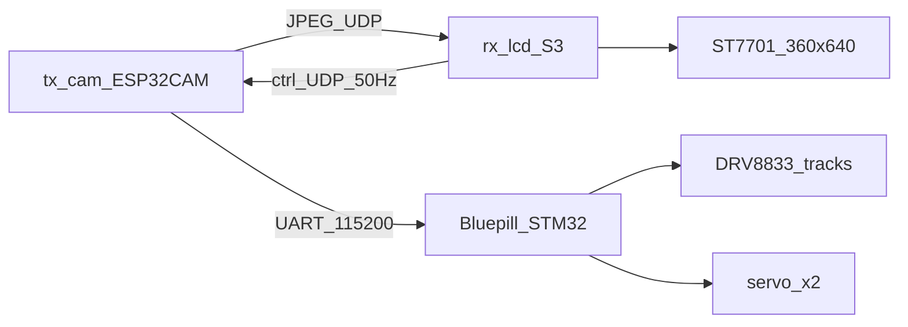

# RC 탱크 영상과 조종

ESP-IDF로 영상과 조종을 나눈다. ESP32-CAM은 JPEG을 보내고 조종 UDP를 UART로 Bluepill에 넘긴다. STM32가 DRV8833과 서보를 직접 구동한다. 수신기는 ESP32-S3-WROOM-1-N16R8과 ST7701 360×640이다.

ESP32 펌웨어 둘은 ESP-IDF, 모터 보드는 STM32Cube HAL이다.

## 하드웨어

수신 모듈은 **ESP32-S3-WROOM-1-N16R8** (16MB 플래시, 8MB 옥탈 PSRAM)이다. 모듈 핀은 밖으로 안 나오므로, 이 모듈이 실장된 **ESP32-S3-DevKitC-1**을 수신 보드로 쓴다.

ST7701을 이 보드에 쓰는 이유:

- ST7701은 패널 안에 프레임 메모리가 없다. 3선 SPI로 초기화한 뒤, 16비트 RGB 병렬 버스(PCLK, DE, HSYNC, VSYNC, D0–D15)로 화면을 계속 갱신한다.
- 한 프레임은 360×640×2 = **460,800바이트**이다. N16R8의 옥탈 PSRAM에 두고, 내부 SRAM의 바운스 버퍼로 RGB DMA를 먹인다.
- 일반 ESP32에는 이 RGB 컨트롤러가 없다. N16R8에는 있다.
- 비압축 전송은 초당 10장도 약 4.6MB/s라 불가하다. ESP32-CAM(OV2640)이 **320×240 JPEG**을 보내고, 수신측이 RGB565로 풀어 화면에 붙인다.

착수 전에 패널 커넥터를 확인한다. PCLK, DE, HSYNC, VSYNC, D0–D15가 있어야 한다. MIPI DSI 레인만 있는 패널이면 S3로 구동할 수 없다.

N16R8에서 **GPIO35–GPIO37은 PSRAM 전용**이라 LCD에 쓰지 않는다. GPIO19/20은 DevKit USB, GPIO43/44는 로그 UART로 남겨 둔다. RGB 20선 + SPI 3선 + RST + 백라이트는 나머지 핀으로 배치하고, 패널 브레이크아웃 실크와 대조해 확정한다.

## 목표 성능

- 해상도: 320×240 JPEG, 품질 10–12
- 프레임: 초당 8–12장
- 지연: 약 150–300ms
- 화면: 360×640 중앙에 1:1로 그리고, 나머지는 검은색. 4:3 영상을 9:16으로 늘리지 않는다. 확대는 화면이 안정된 뒤에 넣는다.

탱크를 보며 천천히 조종하는 확인 영상 기준이다.

## 구조

- 수신 보드가 SoftAP `tank-rx`를 연다. 카메라가 접속한 뒤 영상 UDP를 푸시하고, 수신기가 다른 포트로 조종 UDP를 50Hz로 보낸다. 공유기 없이 1:1로 붙는다.
- 영상 조각을 잃으면 그 프레임은 버리고 이전 화면을 유지한다.
- 영상 헤더: magic `0xA55A`, frame id, fragment index/count, payload length, payload 최대 1400바이트.
- 조종은 영상 소켓과 분리한다. 카메라는 최신 패킷만 남기고, 늦게 도착한 이전 순번은 버린다.

## 전송은 Wi-Fi UDP

영상은 Wi-Fi UDP로 보낸다. ESP-NOW로 바꾸면 이 영상의 속도나 전력이 좋아지지 않는다.

- 필요한 대역은 320×240 JPEG 8–15KB를 초당 10장이면 약 0.6–1.2Mbps이다.
- ESP-NOW 기본 속도는 1Mbps이고, Espressif 측정 실효 처리량은 열린 공간에서 약 214Kbps이다. 그 속도면 같은 JPEG이 초당 2장 전후이다. PHY를 올리면 QVGA JPEG 초당 9–14장까지 보고된 예가 있어 목표에는 닿을 수 있지만, Wi-Fi UDP의 수 Mbps 여유에는 못 미친다.
- v1 페이로드는 250바이트라 12KB 한 장이 약 48조각이다. IDF 5.4 이상의 v2는 1470바이트라 UDP와 조각 수가 비슷해진다. 조각이 줄어도 기본 레이트의 처리량 한계는 그대로이다.
- 전력은 페이로드가 아니라 송신 시간이 좌우한다. 기본 1Mbps는 같은 프레임을 더 오래 내보내 탱크 쪽 전류가 늘 수 있다. SoftAP 비컨을 아끼는 양은 카메라와 연속 송신 전류에 비해 작다. 수신 쪽은 백라이트와 패널이 대부분이다.
- ESP-NOW도 같은 Wi-Fi 라디오이다. S3에서 RGB DMA와 라디오가 겹치는 문제는 그대로이다. Long Range 모드는 거리를 늘리는 대신 처리량이 더 내려가 영상에는 쓰지 않는다.

조종은 짧은 패킷이라 ESP-NOW로도 보낼 수 있다. 영상이 이미 Wi-Fi를 켜 두므로 같은 라디오의 별도 UDP 포트로 보낸다.

## 탱크 안 링크는 UART

ESP32-CAM은 영상과 무선만 하고, PWM과 페일세이프는 Bluepill이 한다. 카메라가 쓰는 핀이 많고, Wi-Fi 지연이 모터 펄스에 섞이면 안 된다. STM32 타이머가 20kHz와 서보 50Hz를 무선과 무관하게 유지한다.

ESP32와 STM32는 **UART 115200 8N1**로 잇는다. 조종 프레임은 13바이트, 50Hz면 초당 1KB 미만이라 이 속도면 충분하다. 선은 TX, RX, GND 세 가닥이고 논리 전압은 둘 다 3.3V라 레벨 시프터 없이 직결한다.

- ESP32-CAM UART1: TX GPIO14, RX GPIO13. 카메라 핀과 부트 스트랩을 피한다. GPIO12는 부트 때 LOW여야 하는데 STM32 TX 유휴 레벨이 HIGH라 수신 핀으로 쓰면 부트가 깨진다. GPIO1/GPIO3 UART0는 플래시와 로그용으로 남긴다.
- Bluepill USART1: TX PA9, RX PA10. ESP32 TX는 PA10에, ESP32 RX는 PA9에 연결한다. SWD(PA13, PA14)는 디버그용으로 비운다.
- 프레임: magic `0xC3A5`, seq, 좌측/우측 트랙 `int16` −1000..1000, 서보 2채널 펄스 폭 `uint16` 마이크로초(1500이 중앙), CRC16. STM32는 CRC가 맞는 최신 seq만 적용한다.
- 역방향은 10Hz로 magic `0xC3A6`, DRV8833 nFAULT, 배터리 mV, CRC. 카메라는 이 상태를 조종과 별도로 수신기에 전달할 수 있다.
- 페일세이프는 STM32에 둔다. 200ms 동안 정상 프레임이 없으면 DRV8833 두 입력을 HIGH로 브레이크하고, 서보는 마지막 각도를 유지한다. 카메라도 무선 조종이 200ms 끊기면 UART 전달을 멈춰 타임아웃이 걸리게 한다.

I2C는 쓰지 않는다. F103을 I2C 슬레이브로 두면 클럭 스트레치와 BUSY 플래그 문제가 잦다. SPI는 50Hz 조종에 비해 선이 많고, 카메라 보드에 여유 핀이 없다. CAN은 ESP32 TWAI와 F103 bxCAN으로 가능하지만 트랜시버가 양쪽에 필요하다. 차체 안 짧은 선이면 UART와 CRC로 충분하다. 보드를 떨어뜨려 길게 배선하게 되면 그때 CAN으로 바꾼다.

### 액추에이터 핀

- DRV8833 좌측 AIN1/AIN2 = PA6/PA7 (TIM3 CH1/CH2), 우측 BIN1/BIN2 = PB0/PB1 (TIM3 CH3/CH4). 20kHz. 전진은 한쪽 PWM·반대 0, 후진은 반대, 브레이크는 둘 다 HIGH. nSLEEP은 PB5 HIGH. nFAULT는 PB12 풀업.
- 서보 2개는 TIM2 PA0, PA1. 주기 20ms, 펄스 1000–2000µs. 신호는 3.3V이다.
- DRV8833 한 채널 연속 전류는 약 1.5A이다. 모터가 이보다 크면 드라이버를 바꿔야 한다.
- 모터 전원과 서보 5V는 Bluepill 레귤레이터에서 따지 않는다. ESP32-CAM 5V도 별도 BEC이다. GND만 한 점에서 묶는다. 모터 전류가 카메라 전원으로 들어가면 브라운아웃으로 Wi-Fi가 끊긴다.

## 펌웨어

레포 루트에 프로젝트를 셋으로 나눈다. ESP 둘만 ESP-IDF이다.

- `tx_cam`: 타깃 ESP32, AI-Thinker ESP32-CAM. `esp_camera`로 QVGA JPEG, 더블 버퍼, `CAMERA_GRAB_LATEST`. 캡처 후 즉시 영상 UDP 전송. 목표 간격 100ms. 다른 태스크가 조종 UDP를 받아 최신 값만 UART1로 전달한다.
- `rx_lcd`: 타깃 ESP32-S3, PSRAM 옥탈. `espressif/esp_lcd_st7701`과 3선 SPI IO (`esp_lcd_panel_io_additions`). JPEG 디코더는 `espressif/esp_new_jpeg`. 50Hz로 조종 UDP를 보낸다. 스틱·버튼의 실제 ADC 핀은 핸드헬드 배선이 정해지면 넣는다.
- `tank_ctrl`: STM32F103 Bluepill, STM32Cube HAL. UART 수신, TIM3 모터 PWM, TIM2 서보, 200ms 페일세이프. ESP-IDF로 빌드하지 않는다.

수신 쪽 순서:

1. ST7701 초기화 후 단색, 이어서 컬러 바. 여기서 핀과 porch, PCLK을 맞춘다. 360×640 타이밍은 480×480 예제와 다르다. 제조사 init 시퀀스가 있으면 그것을 쓰고, 없으면 PCLK 10–16MHz에서 porch를 조정한다.
2. UDP 수신과 JPEG 디코드를 붙여 320×240을 프레임버퍼 중앙에 복사한다.
3. 불완전 프레임 폐기, 수신 FPS 로그.

RGB DMA가 PSRAM을 계속 읽으므로 Wi-Fi와 대역을 나눈다. 바운스 버퍼는 가로 픽셀의 10배(10×360)로 두고, 눈이 튀면 PCLK과 JPEG 프레임레이트를 먼저 낮춘다.

## 범위 밖

핸드헬드 스틱의 물리 핀과 외장, 배터리 잔량을 화면에 그리는 UI는 아직 정하지 않는다. 조종 패킷 형식과 탱크 안 UART·PWM·페일세이프는 이 문서 범위에 포함한다.
