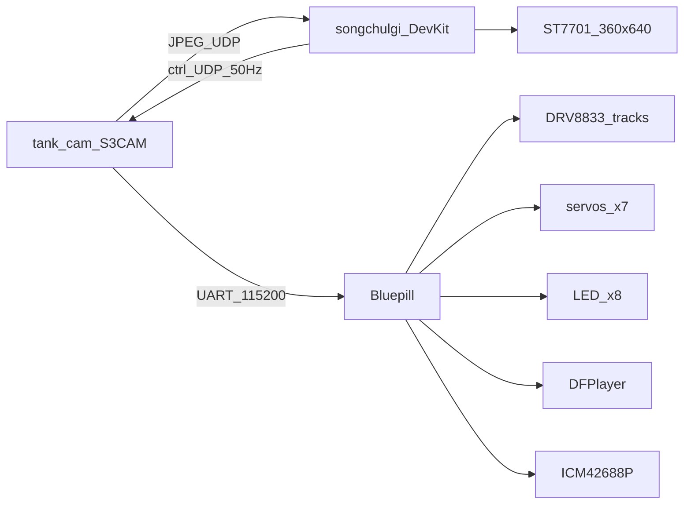

# RC 탱크 영상과 조종

이름은 전파 방향이 아니라 역할로 붙입니다.

- **수신기**는 탱크입니다. 영상을 보내고 조종을 받습니다. ESP32-S3-CAM N16R8, Bluepill, DRV8833, 서보, LED, DFPlayer, ICM-42688-P가 여기 있습니다.
- **송출기**는 조종기입니다. 영상을 받아 화면에 그리고 조이스틱과 버튼을 보냅니다. ESP32-S3-DevKitC-1 N16R8, ST7701 360×640, ADS1115가 여기 있습니다.

송출기를 S3-CAM으로 바꾸지 않습니다. 카메라가 연결된 상태의 여유 핀은 6개 안팎이라 16비트 RGB에 부족합니다. ESP 펌웨어 둘은 ESP-IDF, 모터 보드는 STM32 HAL입니다.

## 왜 이 조합인가

- ST7701은 패널 안에 프레임 메모리가 없습니다. 3선 SPI로 초기화한 뒤, 16비트 RGB 병렬 버스(PCLK, DE, HSYNC, VSYNC, D0–D15)로 화면을 계속 갱신합니다.
- 한 프레임은 360×640×2 = **460,800바이트**입니다. N16R8의 옥탈 PSRAM에 두고, 내부 SRAM의 바운스 버퍼로 RGB DMA를 먹입니다.
- 일반 ESP32에는 이 RGB 컨트롤러가 없습니다. N16R8에는 있습니다.
- 비압축 전송은 초당 10장도 약 4.6MB/s라 불가합니다. S3-CAM의 카메라(OV2640 또는 OV5640, 보드 로트마다 다름)가 **320×240 JPEG**을 보내고, 송출기가 RGB565로 풀어 화면에 붙입니다. 프레임 버퍼는 PSRAM에 둡니다.

착수 전에 패널 커넥터를 확인합니다. PCLK, DE, HSYNC, VSYNC, D0–D15가 있어야 합니다. MIPI DSI 레인만 있는 패널이면 S3로 구동할 수 없습니다.

## 목표 성능

- 해상도: 320×240 JPEG, `jpeg_quality` 32–40. ESP32 카메라 스케일에서 숫자가 클수록 압축이 세고 화질이 거칠다. 시작값은 36이고, 장수가 모자라면 42까지 올린 뒤에야 해상도를 낮춘다.
- 프레임: 초당 25–30장. 패널 갱신이 약 30Hz라 그 위의 장은 화면에 더 부드럽게 보이지 않는다.
- 지연: 약 150–300ms
- 화면: 360×640 중앙에 1:1로 그리고, 나머지는 검은색. 4:3 영상을 9:16으로 늘리지 않습니다. 확대는 화면이 안정된 뒤에 넣습니다.
- 송출기 패널 갱신은 약 30Hz. 콘텐츠가 60장이 아니므로 PCLK를 낮춰 RGB DMA가 차지하는 PSRAM 대역을 줄입니다. 보이는 영상은 초당 30장이 맞습니다.

탱크를 보며 천천히 조종하는 확인 영상 기준입니다.

## 구조

- 송출기가 SoftAP `tank-rx`를 엽니다. 수신기가 접속한 뒤 영상 UDP를 푸시하고, 송출기가 다른 포트로 조종 UDP를 50Hz로 보냅니다. 공유기 없이 1:1로 붙습니다.
- 영상 조각을 잃으면 그 프레임은 버리고 이전 화면을 유지합니다.
- 영상 헤더: magic `0xA55A`, frame id, fragment index/count, payload length, payload 최대 1400바이트.
- 조종은 영상 소켓과 분리합니다. 수신기는 최신 패킷만 남기고, 늦게 도착한 이전 순번은 버립니다.
- 조종 값은 송출기의 조이스틱 둘과 버튼 넷에서 나옵니다. 축은 ADS1115가 읽고, 수신기 S3-CAM이 UART로 Bluepill에 넘깁니다.

## 전송은 Wi-Fi UDP

ESP-NOW로 바꾸면 이 영상의 속도나 전력이 좋아지지 않습니다. 영상은 Wi-Fi UDP를 유지합니다.

- 필요한 대역은 320×240 JPEG 8–15KB를 초당 10장이면 약 0.6–1.2Mbps입니다.
- ESP-NOW 기본 속도는 1Mbps이고, Espressif 측정 실효 처리량은 열린 공간에서 약 214Kbps입니다. 그 속도면 같은 JPEG이 초당 2장 전후입니다. PHY를 올리면 QVGA JPEG 초당 9–14장까지 보고된 예가 있어 목표에는 닿을 수 있지만, Wi-Fi UDP의 수 Mbps 여유에는 못 미칩니다.
- v1 페이로드는 250바이트라 12KB 한 장이 약 48조각입니다. IDF 5.4 이상의 v2는 1470바이트라 UDP와 조각 수가 비슷해집니다. 조각이 줄어도 기본 레이트의 처리량 한계는 그대로입니다.
- 전력은 페이로드가 아니라 송신 시간이 좌우합니다. 기본 1Mbps는 같은 프레임을 더 오래 내보내 탱크 쪽 전류가 늘 수 있습니다. SoftAP 비컨을 아끼는 양은 카메라와 연속 송신 전류에 비해 작습니다. 송출기 쪽은 백라이트와 패널이 대부분입니다.
- ESP-NOW도 같은 Wi-Fi 라디오입니다. S3에서 RGB DMA와 라디오가 겹치는 문제는 그대로입니다. Long Range 모드는 거리를 늘리는 대신 처리량이 더 내려가 영상에는 쓰지 않습니다.

조종은 짧은 패킷이라 ESP-NOW로도 보낼 수 있습니다. 영상이 이미 Wi-Fi를 켜 두므로 같은 라디오의 별도 UDP 포트로 보냅니다.

## 탱크 안 링크는 UART

S3-CAM은 영상과 무선만 하고, PWM과 페일세이프는 Bluepill이 합니다. 이 분리가 맞습니다. 카메라가 쓰는 핀이 많고, Wi-Fi 지연이 모터 펄스에 섞이면 안 됩니다. STM32 타이머가 20kHz와 서보 50Hz를 무선과 무관하게 유지합니다.

ESP32와 STM32는 **UART 115200 8N1**로 잇습니다. 조종 프레임은 14바이트, 50Hz면 초당 1KB 미만이라 이 속도면 충분합니다. 선은 TX, RX, GND 세 가닥이고 논리 전압은 둘 다 3.3V라 레벨 시프터 없이 직결합니다.

- S3-CAM UART1: TX GPIO14, RX GPIO21. 카메라(GPIO4–13, 15–18), 옥탈 PSRAM(GPIO35–37), SD(GPIO38–40), 로그 UART(GPIO43/44)를 피합니다. 카메라가 켜진 채 조건 없이 남는 핀은 GPIO1, 14, 21, 41, 42, 47 정도입니다.
- Bluepill USART1: TX PA9, RX PA10. ESP32 TX는 PA10에, ESP32 RX는 PA9에 연결합니다. SWD(PA13, PA14)는 디버그용으로 비웁니다.
- 프레임: magic `0xC3A5`, seq, 좌측/우측 트랙 `int16` −1000..1000, 터렛과 포신 펄스 폭 `uint16` 마이크로초(1500이 중앙), 버튼 `uint8`의 하위 4비트, CRC16. 리코일과 추가 서보 4개의 각도는 패킷에 넣지 않습니다. Bluepill이 버튼으로 그 동작을 재생합니다. STM32는 CRC가 맞는 최신 seq만 적용합니다.
- 역방향은 10Hz로 magic `0xC3A6`, DRV8833 nFAULT, 배터리 mV, CRC. S3-CAM은 이 상태를 조종과 별도 UDP로 송출기에 전달할 수 있습니다.
- 페일세이프는 STM32에 둡니다. 200ms 동안 정상 프레임이 없으면 DRV8833 두 입력을 HIGH로 브레이크하고, 터렛과 포신과 추가 서보는 마지막 각도를 유지합니다. 리코일 서보는 원위치로 되돌립니다. LED는 마지막 상태를 유지합니다. 수신기 카메라도 무선 조종이 200ms 끊기면 UART 전달을 멈춰 타임아웃이 걸리게 합니다.

탱크 안 ESP와 STM32 사이는 I2C를 쓰지 않습니다. F103을 I2C 슬레이브로 두면 클럭 스트레치와 BUSY 플래그 문제가 잦습니다. SPI는 50Hz 조종에 비해 선이 많습니다. CAN은 트랜시버가 양쪽에 필요합니다. 차체 안 짧은 선이면 UART와 CRC로 충분합니다. 보드를 떨어뜨려 길게 배선하게 되면 그때 CAN으로 바꿉니다. I2C는 송출기 DevKit의 ADS1115와, 수신기 Bluepill이 마스터로 읽는 ICM-42688-P에만 씁니다.

액추에이터는 모두 수신기 Bluepill에 있습니다.

- DRV8833 좌측 AIN1/AIN2 = PA6/PA7 (TIM3 CH1/CH2), 우측 BIN1/BIN2 = PB0/PB1 (TIM3 CH3/CH4). 20kHz. 전진은 한쪽 PWM·반대 0, 후진은 반대, 브레이크는 둘 다 HIGH. nSLEEP은 PB5 HIGH. nFAULT는 PB12 풀업. 좌측 조이스틱의 세로를 전후, 가로를 선회로 섞은 좌우 트랙 값으로 앞뒤를 결정합니다.
- 서보 7개, 주기 20ms, 펄스 1000–2000µs, 신호 3.3V. 터렛 회전 PA0, 포신 상하 PA1 (TIM2, 우측 조이스틱). 리코일 PA2. 추가 서보 4개는 PA3, PB6, PB7, PA8(TIM1 CH1). 우측 조이스틱은 포신의 좌우(터렛)와 상하만 연속으로 움직입니다. 리코일과 추가 4개는 버튼 동작으로 Bluepill이 재생합니다.
- LED 8개는 PB13, PB14, PB15, PA4, PA5, PA15, PC13, PB3입니다. PB3는 JTAG를 끄고 SWD만 남긴 뒤 GPIO로 씁니다. 저항을 달아 핀당 약 8mA 이하로 켭니다. 버튼 4개가 패턴과 나머지 동작을 고릅니다.
- ICM-42688-P는 Bluepill이 I2C 마스터로 읽습니다. SCL PB8, SDA PB9, 주소 `0x68`, AD0는 GND. VDD와 VDDIO는 Bluepill 3.3V에 같이 물립니다. 허용 범위는 1.71–3.6V이고 저잡음 6축 전류는 약 0.88mA입니다. 칩 옆 VDD에 0.1µF와 2.2µF, VDDIO에 10nF를 답니다. 서보 BEC나 모터 전원에는 물리지 않습니다. 데이터시트 전원 잡음 한도는 10mV p-p입니다. 칩의 Z축을 위로 두고 차체 회전 중심에 가깝게 고정합니다. 샘플 200Hz, 자이로 Z에 약 20Hz 저역 필터를 겁니다. 부팅 후 정지 상태에서 약 1초간 바이어스를 잽니다. 초기 영점 오차는 약 ±0.5°/s, 온도 계수는 약 ±0.005°/s/°C입니다.
- DFPlayer Mini는 USART3 TX PB10, RX PB11, 9600bps. 전원은 5V입니다. 효과음은 버튼 동작과 리코일에 맞춰 Bluepill이 트랙 번호를 보냅니다.
- DRV8833 한 채널 연속 전류는 약 1.5A입니다. 모터가 이보다 크면 드라이버를 바꿔야 합니다. 서보 7개의 5–6V는 서보 전용 BEC에서 따고, Bluepill 레귤레이터와 S3-CAM 5V와 분리합니다. GND만 한 점에서 묶습니다. 차체가 금속이면 PCB 안테나가 가려지므로, IPEX가 있는 보드를 고르면 안테나를 밖으로 냅니다.

## 펌웨어

레포 루트에 프로젝트를 셋으로 나눕니다. ESP 둘만 ESP-IDF입니다.

- `tank_cam`: 수신기. 타깃 ESP32-S3, ESP32-S3-CAM N16R8. PSRAM 옥탈. `esp_camera`로 QVGA JPEG, 품질 36(허용 32–40), 프레임 버퍼는 PSRAM, 더블 버퍼, `CAMERA_GRAB_LATEST`. Wi-Fi 절전은 끄고 채널은 고정합니다. 캡처 후 즉시 영상 UDP 전송. 목표 간격 33–40ms. 다른 태스크가 조종 UDP를 받아 최신 값만 GPIO14/21 UART로 전달합니다.
- `console`: 송출기. 타깃 ESP32-S3, PSRAM 옥탈. `espressif/esp_lcd_st7701`과 3선 SPI IO (`esp_lcd_panel_io_additions`). JPEG 디코더는 `espressif/esp_new_jpeg`. Wi-Fi는 코어 0, 디코드와 창 복사는 코어 1. 320×240 RGB565(약 150KB)는 내부 SRAM에 풀고 PSRAM 프레임버퍼에는 그 사각형만 복사합니다. 50Hz로 ADS1115 네 축과 버튼 4비트를 실은 조종 UDP를 보냅니다.
- `tank_ctrl`: 수신기 STM32F103 Bluepill, STM32Cube HAL. UART 수신, TIM3 트랙, TIM2/TIM4/TIM1 서보 7개, LED 8개, USART3 DFPlayer, ICM-42688-P 요 각속도 보정, 200ms 페일세이프. ESP-IDF로 빌드하지 않습니다.

송출기 화면 순서:

1. ST7701 초기화 후 단색, 이어서 컬러 바. 여기서 핀과 porch, PCLK을 맞춥니다. 360×640 타이밍은 480×480 예제와 다릅니다. 제조사 init 시퀀스가 있으면 그것을 쓰고, 없으면 PCLK 10–16MHz에서 porch를 조정합니다.
2. UDP 수신 후 코어 1에서 JPEG을 내부 SRAM의 320×240 버퍼에 풀고, 그 사각형만 프레임버퍼 중앙에 복사합니다.
3. 불완전 프레임 폐기, 수신 FPS 로그.

N16R8에서 **GPIO35–GPIO37은 PSRAM 전용**이라 LCD에 쓰지 않습니다. GPIO19/20은 DevKit USB, GPIO43/44는 로그 UART로 남겨 둡니다. RGB 20선 + SPI 3선 + RST + 백라이트는 나머지 핀으로 배치하고, 패널 브레이크아웃 실크와 대조해 확정합니다.

RGB DMA가 PSRAM을 계속 읽으므로 Wi-Fi와 대역을 나눕니다. 바운스 버퍼는 가로 픽셀의 10배(10×360)로 둡니다. 패널 갱신은 약 30Hz로 낮추고, 디코드 결과는 내부 SRAM에 둡니다. 그래도 눈이 튀면 JPEG 품질을 먼저 더 올립니다(숫자를 키워 용량을 줄임).

## FPS 결정

병목은 대개 송출기다. S3가 JPEG을 푸는 동안 RGB DMA가 460KB 프레임버퍼를 PSRAM에서 계속 읽는다. 송출기 파이프라인과 JPEG 품질 32–40으로 목표를 초당 25–30장으로 올린다. 수신기 카메라는 ESP32-S3-CAM N16R8이라 그 장수를 50Hz 조종과 함께 유지한다. XIAO Sense와 같은 S3와 8MB 옥탈 PSRAM이라 프레임 성능은 같고, 보드 가격이 낮다.

수신기 S3-CAM에서 얻는 것:

- JPEG 버퍼를 PSRAM에 두어 캡처와 전송이 내부 RAM에서 겹치지 않는다. 일반 ESP32-CAM 대비 초당 25–30장과 조종 수신이 같이 유지된다.
- 많은 보드가 USB로 바로 플래시된다.

그대로이거나 나빠진 것:

- QVGA 화질과 송출기 파이프라인은 그대로다. 전력도 줄지 않는다.
- 카메라가 켜지면 여유 핀이 약 6개라 UART는 GPIO14/GPIO21만 쓴다.
- 대부분 PCB 안테나이다. IPEX가 없으면 금속 차체 안에서 도달 거리가 XIAO의 외부 안테나보다 짧다.
- 송출기를 같은 CAM 보드로 바꾸면 RGB 20선을 뽑을 핀이 없다. 송출기는 DevKitC-1 N16R8을 유지한다.

제외한 후보:

- QQVGA 160×120. 품질을 더 올려도 초당 30장이 안 나올 때 검토한다. 화면의 영상이 더 작아진다.
- ESP32-P4 하드웨어 JPEG 디코더. Wi-Fi 칩이 따로 필요하고 ST7701 RGB와 맞지 않을 수 있다.
- ESP-NOW와 비압축 RGB565. 처리량이 더 나빠져 프레임을 올리지 못한다.

## 트랙 직진 보정

송출기가 지시한 직진에서도 트랙 마찰과 모터 차이가 나면 차체가 옆으로 샙니다. ICM-42688-P 자이로 Z로 실제 요 각속도를 재고, Bluepill이 좌우 PWM에 같은 크기의 반대 보정을 더합니다. MPU6050 대신 이 센서를 씁니다. 초기 영점이 ±0.5°/s 수준이고 온도 계수가 ±0.005°/s/°C라, 모터 열로 영점이 덜 밀립니다. 보정은 수신기 안에서 닫습니다. 송출기까지 왕복하면 영상 지연이 섞입니다.

- 왼쪽 스틱 가로가 가운데면 목표 요 각속도는 0입니다. 측정값이 0이 아니면 느린 쪽 트랙 PWM을 올립니다.
- 스틱이 선회를 명령하면 목표 각속도를 그 명령에 맞춥니다. 스틱이 이미 만든 좌우 차이에 보정량을 더합니다.
- 정지(전후와 선회가 모두 데드존)에서는 적분을 멈추고 PWM을 0으로 둡니다. 진동 바이어스가 정지 중에 트랙을 밀지 않게 합니다.
- 이 루프는 수 초에서 수십 초의 직진 쏠림을 줄입니다. 자이로만으로는 절대 방위가 없고 바이어스가 쌓이므로, 긴 시간 동안 같은 나침반 방향을 유지하지는 못합니다. 가속도는 요 보정에 쓰지 않습니다. 트랙 진동이 중력 방향 측정에 섞입니다.

## 송출기 입력

송출기 DevKit이 조이스틱 둘과 버튼 넷을 읽어 50Hz 조종 UDP로 수신기에 보냅니다. 축은 DevKit 내부 ADC를 쓰지 않습니다. ESP32-S3 ADC는 잡음과 비선형성이 있고, ADC2는 Wi-Fi와 핀이 겹칩니다. RGB 패널이 핀을 많이 쓰므로 네 축은 I2C ADC 한 칩으로 받습니다.

- **ADS1115**, 주소 `0x48`(ADDR는 GND). 전원 3.3V. PGA ±4.096V, 단일 입력. 860SPS 원샷으로 20ms마다 네 축을 읽으면 변환은 약 5ms입니다.
- I2C 우선 핀은 SDA GPIO8, SCL GPIO9. 패널 실크가 이 핀을 쓰면 LCD 맵을 정한 뒤 남는 핀으로 옮깁니다.
- 왼쪽 조이스틱은 AIN0(세로, 전후), AIN1(가로, 선회)입니다. 가운데 약 ±8%는 0으로 묶어 트랙이 스스로 움직이지 않게 하고, 좌우 트랙 −1000..1000으로 섞습니다.
- 오른쪽 조이스틱은 AIN2(좌우, 터렛), AIN3(상하, 포신)입니다. 가운데 1500µs, 양끝 1000–2000µs로 바꿉니다. 같은 데드존을 둡니다.
- 버튼 4개는 ADC에 넣지 않습니다. 내부 풀업, 눌림 LOW, 디바운스 20ms. 하위 4비트로 STM32까지 전달합니다. 각 버튼이 LED 패턴, 리코일, 추가 서보, DFPlayer 중 무엇을 할지는 버튼 배치가 정해지면 넣습니다.

## 이번 범위 밖

버튼 4개의 개별 동작과 송출기 외장, 배터리 잔량을 화면에 그리는 UI는 아직 정하지 않습니다. 조종 패킷, 수신기 UART·트랙·서보 7개·LED 8개·DFPlayer·ICM-42688-P 직진 보정·페일세이프, ADS1115 네 축은 이번 범위에 포함합니다.
